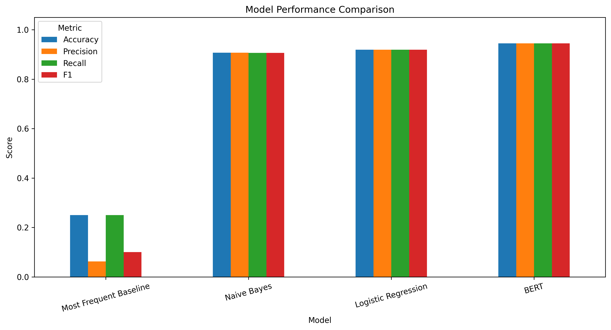

# AG News: TF–IDF baselines and BERT

A reproducible comparison of sparse text classifiers and a fine-tuned BERT encoder, with an auditable paired error analysis on 7,600 AG News test examples.

**Research artifact · single-run benchmark study · MIT-licensed code**

[Research report](writeup/paper.pdf) · [Report source](writeup/paper.md) · [Slides](presentation/slides.pdf) · [Methods and provenance](docs/REPRODUCIBILITY.md) · [Contributing](CONTRIBUTING.md)

The saved BERT predictions achieve **94.25% accuracy**, compared with **91.80%** for TF–IDF Logistic Regression. BERT gains **2.45 percentage points** (186 additional correct predictions). This repository supports inspecting those results offline, training new models, and classifying new text with locally saved models.

## Quick start

Validated with Python 3.12 on Linux, using CPU PyTorch. GPU training is optional. Dataset and pretrained-model downloads require access to Hugging Face; no token is needed for these public assets.

```bash
python -m venv .venv
source .venv/bin/activate
# CPU installation avoids downloading unnecessary CUDA libraries.
pip install --index-url https://download.pytorch.org/whl/cpu torch==2.4.1
pip install -r requirements.txt
pip check
```

The direct dependencies are pinned. For the complete Linux/Python 3.12 dependency snapshot tested for this revision, install `requirements.lock.txt` after the CPU PyTorch command. These pins describe the current development environment, not recovered metadata for the historical training run.

### Inspect the research results without downloads

```bash
python src/research_analysis.py --output-dir runs/paired-audit
python src/overlap_analysis.py --output-dir runs/error-review
MPLBACKEND=Agg python src/plot.py --output-dir runs/figures
python -m unittest discover -s tests -v
```

Every output directory must be empty or new. The checked-in `results/` directory contains historical experiment artifacts and the derived audit in `results/analysis/`; commands do not overwrite them by default.

### Train classical models and classify a headline

```bash
python src/baseline_models.py --output-dir runs/baselines --seed 42
python src/predict.py \
  --model runs/baselines/models/logistic_regression.joblib \
  --text "Technology company unveils a new computer chip"
```

The training command downloads AG News, fits TF–IDF on training data only, evaluates development and test splits, and saves fitted Logistic Regression and Naive Bayes pipelines. Predictions are JSON with label IDs, names and class probabilities. Load only trusted `.joblib` files: their serialization format can execute code. Scores are model probabilities and have not been calibrated as reliability estimates.

### Fine-tune BERT

```bash
python src/bert_model.py --output-dir runs/bert --seed 42 \
  --epochs 2 --batch-size 8 --max-length 128 --learning-rate 2e-5
python src/predict.py --model runs/bert/models/bert \
  --text "The national team wins the tournament"
```

The best checkpoint is selected by development loss. Tokenizer and model are saved for local inference. Full training over 108,000 examples is costly on CPU; use a compatible CUDA PyTorch installation for GPU training. This repository does **not** distribute the historical fine-tuned BERT checkpoint. Local integration tests use a tiny randomly initialized BERT and do not reproduce the reported full-model scores.

Use `--dataset-revision <commit>` and, for BERT, `--model-revision <commit>` to pin external inputs. Use `--help` for options. New training runs record split fingerprints, seed, settings and package versions.

## Experimental protocol

AG News contains four balanced classes: **World (0), Sports (1), Business (2), Sci/Tech (3)**. The official 120,000-example training set is split into 108,000 training and 12,000 development examples, stratified by label with seed 42. The official test set has 7,600 examples.

Classical models use lowercased TF–IDF unigrams and bigrams, English stop-word removal, and a 20,000-feature limit. Multinomial Naive Bayes uses default smoothing; Logistic Regression uses L2 regularization and `max_iter=2000`. No classical hyperparameter search is implemented. BERT uses `bert-base-uncased`, 128-token truncation, AdamW, learning rate 2e-5, batch size 8, weight decay 0.01, and two epochs. Development loss selects the BERT checkpoint. The mode baseline uses labels only.

### Historical test results

Precision, recall and F1 are **macro-averaged**. The LR and BERT rows have been independently recomputed from the saved predictions; the other rows are supplied historical summaries.

| Model | Accuracy | Precision | Recall | Macro-F1 |
| --- | ---: | ---: | ---: | ---: |
| Most frequent | 0.2500 | 0.0625 | 0.2500 | 0.1000 |
| Multinomial Naive Bayes | 0.9024 | 0.9019 | 0.9024 | 0.9019 |
| Logistic Regression | 0.9180 | 0.9178 | 0.9180 | 0.9178 |
| BERT | **0.9425** | **0.9424** | **0.9425** | **0.9424** |



### What changes on the same test examples?

| Paired outcome | Count |
| --- | ---: |
| Both correct | 6,862 |
| LR wrong, BERT correct | 301 |
| BERT wrong, LR correct | 115 |
| Both wrong | 322 |

A paired bootstrap (10,000 resamples, seed 42) gives a **95% interval of 1.92–2.97 percentage points** for the accuracy difference. Exact two-sided McNemar testing yields **p = 2.71 × 10⁻²⁰**. These estimates condition on the saved models and test data; they do not quantify training-seed variability, distribution shift or the mechanism causing the difference. See the [machine-readable audit](results/analysis/paired_statistics.json).

Business/Sci-Tech accounts for 100 of the 301 gross BERT corrections, but only **40 of the 186 net additional correct predictions**. World/Business confusion reductions total 53 and World/Sports total 42. Gross corrections must not be presented as net improvements. Similar median input lengths (37, 37, 36 and 35 words across the reported partitions) are descriptive; they do not rule out length effects or prove contextual reasoning.

## Current replication check

A full classical training/evaluation run completed with the current Linux/Python 3.12 CPU environment and dataset revision `eb185aade064a813bc0b7f42de02595523103ca4`:

| Model | Historical test accuracy | Current rerun accuracy |
| --- | ---: | ---: |
| Most frequent | 25.00% | 25.00% |
| Multinomial Naive Bayes | 90.24% | 90.16% |
| Logistic Regression | 91.80% | 91.88% |

Test texts and gold labels match the historical LR file exactly. LR predictions differ on 74 examples. Missing original run metadata prevents attributing the difference to a specific cause, so this is a successful execution check with close scores, not exact historical replication. See [verification metadata](results/replication/verification.json), [run configuration](results/replication/baseline_experiment_config.json) and [new prediction labels](results/replication/lr_test_labels.csv). The label file includes example IDs and text hashes; it does not duplicate news text.

The real pretrained BERT tokenizer and safetensors weights were downloaded and one CPU optimizer step completed on training examples. This validates the pretrained execution path; full BERT fine-tuning and its historical test score remain unverified.

## Scope and limitations

- One saved run per model; historical hardware, dataset/model commit IDs and run configuration JSONs are unavailable in this checkout.
- The audit reproduces evaluation from saved predictions; the original training run has not been independently reproduced.
- No domain-shift, calibration, latency, memory or matched-compute benchmark has been performed.
- Label ambiguity and vocabulary overlap are hypotheses requiring additional annotation or controlled experiments.
- This is an academic research artifact, not a peer-reviewed publication or a production news classifier.

The [revised report](writeup/paper.pdf) corrects overstatements in the original course-project PDF. Both original [report](writeup/News_Topic_Classification_Using_Machine_Learning_and_Transformer_Based_Models_main.pdf) and [presentation](presentation/News%20Topic%20Classification%20Using%20Machine%20Learning%20and%20BERT.pdf) remain available as historical documents. Prefer the revised report and slides for current claims.

## Repository map

```text
src/                 Training, local inference, statistics, analysis and plotting
results/csv/         Historical summaries, confusion matrices and prediction tables
results/analysis/    Recomputed statistics, input hashes and descriptive analyses
results/plots/       Historical figures
writeup/paper.md     Editable research report; paper.pdf is the rendered version
presentation/        Editable revised slides, rendered PDF and original slides
scripts/             Document build command
tests/              Offline unit and training/inference integration tests
docs/               Provenance, limitations and manuscript review
```

Build the report and slides with Pandoc and a LaTeX installation:

```bash
bash scripts/build_documents.sh
```

## Citation and reuse

Authors: George Liu, Gordon Zau, Louis Dong, and Zhiqi Zhou. Use [CITATION.cff](CITATION.cff) to cite this repository; cite the AG News dataset and BERT separately when using them. The [MIT license](LICENSE) covers this repository's code. Dataset text and upstream model artifacts retain their own licensing terms; see [data/README.md](data/README.md).
